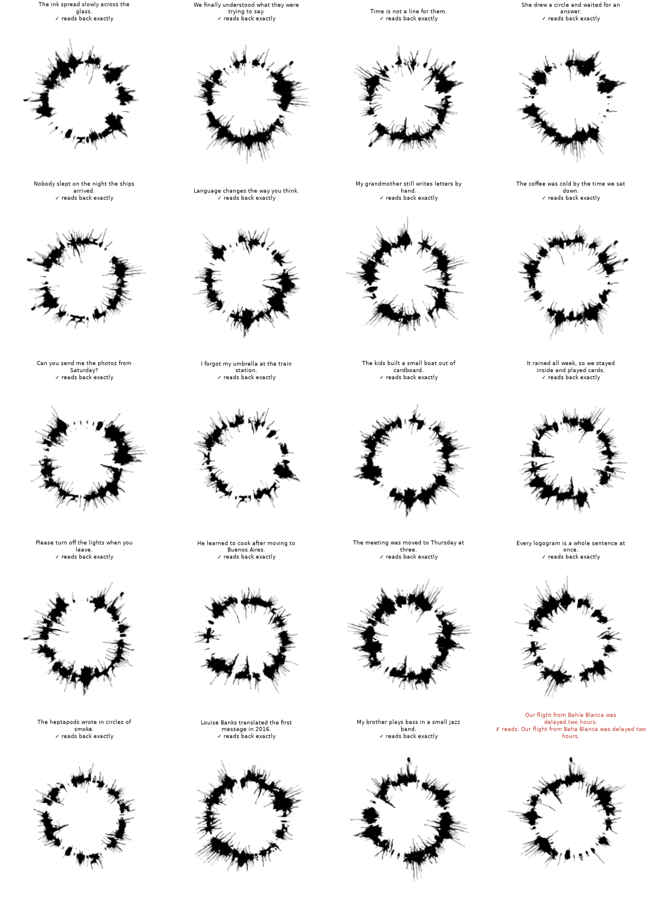

# Heptapod Ink

Two neural networks invent a writing system out of the ink from the film *Arrival*.
One of them writes any short English sentence as a single ring logogram. The other one
looks only at the picture and reads the sentence back.

This is a personal hobby project by Gonzalo Bilune. It is a learned code with a nice
look, not a real alien language, and not something a human can read. The interesting
part is measuring what the networks came up with.



*Twenty rings written by the current model (with the reread step). "✓ reads back exactly" means
the reader recovered the sentence from the image alone. The last one fails because the tokenizer has no "í".*

**[Live demo](https://huggingface.co/spaces/bilune/heptapod-ink)**, runs entirely in your browser. Weights: [bilune/heptapod-ink](https://huggingface.co/bilune/heptapod-ink).

## How it works

```
English sentence
  -> T5-small encoder -> writer: 36 slots, each picks one of 81 ink marks
  -> one ring image (288 x 288 px, real Arrival ink)
  -> "eyes" (polar CNN) -> which mark is in each slot
  -> adapter -> T5-small decoder -> English sentence
```

- **The ink is real.** The 83 marks were cut from the 38 logograms that Wolfram Research
  published from the film. The model keeps the 81 that its eyes can read reliably.
- **The ring is fixed.** 36 slots, one every 10 degrees, starting at 9 o'clock and going
  clockwise. Each mark is about 30 degrees wide, so neighbours overlap. The ring line is the
  same in every logogram, so all the information is in the marks.
- **Nothing is hand-coded.** The only training signal is "the reader must get the text back".
  Which mark means what, and where, is whatever the networks found useful.
- **The writer rereads before sending.** Given its own first ring, the writer tries mark
  swaps and keeps the version a copy of the reader understands best. The receiver still sees
  only pixels. This "reread" step is what takes exact accuracy from 33% to 81%, so every
  number below says which one it is.

Training happens in stages (eyes first, then the code "on paper", then the eyes learn to
read the frozen code). Details in [docs/how-it-works.md](docs/how-it-works.md).

## Results

A locked exam of 2,000 real English sentences (3-12 words, from Universal Dependencies
treebanks the model never saw) was built once, fingerprinted, and evaluated exactly once at
the end. Every reading goes through a saved 16-bit PNG and the eyes. Intervals are 95% Wilson.

| Set | Plain writer, exact | With reread, exact | Words correct (reread) | Reread + unseen image noise | Shuffled-image control |
| --- | --- | --- | --- | --- | --- |
| Natural sentences (2,000) | 33.5% | **81.0%** (79.2-82.7) | 92.9% | 75.5% | 1.2% |
| Random word combinations, 3-10 words (2,000) | 4.1% | 36.8% | 61.3% | 29.8% | 0.6% |
| Uniform random 10-word lists (1,000) | 0.0% | 0.0% | 17.3% | 0.0% | 0.0% |

By length (natural, reread): 3-5 words 94.4%, 6-8 words 87.8%, 9-12 words 67.9%.
The shuffled-image control (giving the reader someone else's ring) confirms the sentence
really travels in the picture, not in the reader's guesses.

Full protocol, breakdowns and probes: [docs/results.md](docs/results.md).

## What we found

- **A subword cliff.** Accuracy depends less on word count than on how many T5 pieces the
  sentence breaks into: 95.8% exact up to 10 pieces, 57.2% at 16-20, 8.9% at 21 or more.
  At exactly 12 words, sentences with light tokenization read 64% exact, dense ones 9%.
- **Its mistakes tend to be close in meaning.** When the plain ring is misread, the wrong word tends to
  be close in meaning ("boat" -> "ship", "glass" -> "mirror"), closer than what T5 guesses from
  context alone (relatedness 0.48 vs 0.36). Much of this seems inherited from T5's own geometry
  rather than invented by the two networks.
- **The ring has functional zones.** Measured over 8,000 sentences, a few slots carry the
  subject (7, 9, 29, 35, written four times over), others the verb and tense, the object
  noun, and how the sentence ends (statement or question). Transplanting the "who" slots
  from another sentence changes the subject 99.5% of the time; random slots, 0%.
- **Some grammar marks are transplantable.** Changing slot 26 alone turns "The teacher is"
  into "The teachers are" on new sentences (97-100%). Past tense uses 2 slots (60%),
  questions and negation need 10-15 slots: the "?" or "don't" always shows up, but the rest of
  the sentence often changes too (30% and 0% exact).
- **Analogies work in the writer's head, not in the pixels.** *Plural - singular + word*
  computed on the writer's internal vectors reads back as the right plural 62% of the time
  (control 2%). Doing the same arithmetic on the images, or copying "the marks that changed",
  does no better than random edits.
- **A stranger can partly learn it.** A fresh reader trained from scratch on 200k
  (sentence, ring) pairs reaches 58.6% exact on simple sentences and 25.4% on web text,
  versus 70.7% and 41.8% for the reader that co-invented the code.
- **Known limits.** Nonsense word lists fail (0% exact on 10 random words). Rare names,
  technical words and numbers cause most remaining errors. Non-ASCII characters like "í" are
  lost because T5's tokenizer cannot write them. A classical codec (language-model arithmetic
  coding plus Reed-Solomon over the same marks) would get around 98%, so the learned code is
  far from the channel's capacity.

## Quickstart

Python 3.11 or newer (developed on 3.13) and a few GB of disk. Run everything from the repo root.

```bash
python -m venv .venv && source .venv/bin/activate
pip install -r requirements.txt
HF_REPO=bilune/heptapod-ink bash scripts/download_models.sh   # weights into v4/runs/s2/ and web/models/
```

Write a sentence and save the ring:

```python
import sys; sys.path.insert(0, "v4")
from pathlib import Path
import heptapod_t5 as H
import search as SR

m, _ = H.load(Path("v4/runs/s2/model.pt"), H.device()); m.eval()
plain = m.code(["Hello, earthling."])                           # first try: (1, 36) mark ids
idx = SR.Searcher(m, rounds=20)(["Hello, earthling."])["idx"]   # reread version
marks = m.fsq_to_mark[idx]                                      # (1, 36) mark id per slot
H.save_png("ring.png", H.export_image(m, marks))
```

A typical example of why rereading matters: the plain ring for "Hello, earthling." reads back as
"Hello, earthly."; the reread ring reads back exactly.

Read it back:

```bash
HEPTAPOD_OUT=v4/runs/s2 python v4/heptapod_t5.py read ring.png
```

Browser demo, locally:

```bash
python web/serve.py        # http://127.0.0.1:8795
```

On a laptop, keep the batch small when rereading (`HEPTAPOD_CHUNK=32`). `PORT=9000` changes the
demo's port.

The small evaluation panels (dev, test, the locked exam and the fresh panels) are in
`v3/data_tatoeba/`. The big training splits are on Hugging Face (`ONLY=data` with the download
script), and `bash scripts/fetch_data.sh` fetches the raw sources (logograms, COGS, Tatoeba, UD) to
rebuild everything. Training needs a GPU; see [v4/README.md](v4/README.md).

### Weights

The weights are not in git. They live on Hugging Face at
[huggingface.co/bilune/heptapod-ink](https://huggingface.co/bilune/heptapod-ink). `scripts/download_models.sh` puts
`model.pt` in `v4/runs/s2/` and the ONNX files in `web/models/`, or you can download them
by hand into those folders. Use `ONLY=pt` or `ONLY=web` to fetch just one part.

## Repo map

| Path | What |
| --- | --- |
| [v4/](v4/README.md) | Current system: T5 writer and reader, reread search, probes, exam scripts |
| [web/](web/README.md) | Browser version (onnxruntime-web), writes and reads rings client-side |
| [v0/](v0/README.md), [v1/](v1/README.md), [v2/](v2/README.md), [v3/](v3/README.md) | Earlier attempts, kept as history ([docs/history.md](docs/history.md)) |
| [reference/](reference/) | The film's logograms and the ink marks cut from them |
| [research/](research/README.md) | Lab notebook: notes, AI-assisted design debates, raw results |
| [docs/](docs/) | [How it works](docs/how-it-works.md), [results](docs/results.md), [history](docs/history.md), [integration](docs/integration.md) for external renderers |
| `scripts/` | Download weights and datasets |
| `hf/` | Hugging Face model card, Space config and publish script |

## Credits and licenses

- **Code:** MIT, see [LICENSE](LICENSE).
- **Ink:** derived from the *Arrival* (2016) logograms by Martine Bertrand, released by
  Wolfram Research ([Arrival-Movie-Live-Coding](https://github.com/WolframResearch/Arrival-Movie-Live-Coding))
  under CC BY-NC 4.0. The marks were cut and modified. Anything derived from the ink,
  including the trained weights, ONNX exports and generated rings, is CC BY-NC 4.0:
  non-commercial use, with attribution.
- **T5-small** (Google) is Apache 2.0. Datasets (Tatoeba, COGS, Universal Dependencies,
  FineWeb, Wikipedia, CC-News) keep their own licenses and are not included here.

The full list is in [NOTICE.md](NOTICE.md). Not affiliated with the film's makers,
Paramount or Wolfram Research.
