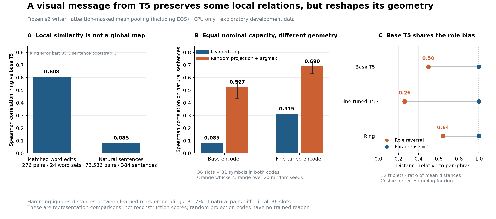

**“A 2D representation of T5” is defensible shorthand only with qualifications.** The precise description is **a learned, lossy visual encoding of a sentence’s T5-derived states, optimized for reconstruction by an adapted T5 decoder.** It represents one input, not T5’s weights, knowledge, or complete “meaning.”

The image occupies two dimensions, but its information-bearing structure is 36 indexed categorical slots arranged circularly: a one-dimensional circular sequence with up to 81 symbols per slot. That gives a nominal maximum of 36·log₂81 = **228.2 bits**, before dependencies and unequal usage. Neither the canvas nor the circular layout makes this a two-dimensional semantic embedding. The fixed ring line carries no information.

The fine-tuned encoder supplies token states; the writer selects a discrete message; slot-specific codebooks and an adapter supply memory to the adapted decoder. Training rewards text reconstruction, not preservation of encoder distances. “What the reader cannot predict” is a useful hypothesis about allocation, but **a minimal residual code has not been demonstrated**: decoder weights and preceding tokens contribute predictions, while the message may retain predictable or redundant material. Fresh-reader learning, imperfect transfer of searched rings, and the subword cliff support a learned, reader-dependent communication system; they do not establish a complete semantic picture.

The existing ring intervention does show semantically graded evidence: synonym boost exceeds contrast boost by **4.673 nats** symbolically and **4.775** visually. These effects are similar, not identical. Repeated words and templates limit the independence of the 92 frames; this result alone cannot locate where semantic organization originated.

**The more interesting finding is a split between local similarity and global geometry.** I ran frozen, offline, CPU-only analyses, each below three minutes, with a 165-second deadline and no training. I sampled 192 sentences each from Tatoeba development and mixed validation pools (seed 505), separately retaining the 92 minimal-pair frames and 12 triplets. These are exploratory development analyses, not another locked-exam evaluation. Encoder vectors use attention-masked mean pooling, including EOS.

Following [representational similarity analysis](https://www.frontiersin.org/journals/systems-neuroscience/articles/10.3389/neuro.06.004.2008/full), I compared upper-triangle cosine distances with code Hamming distances using Spearman correlation. Across **384 sentences / 73,536 dependent pairs**:

| Code / reference geometry | Spearman ρ |
| --- | ---: |
| Learned ring / base T5 | **0.085** |
| Learned ring / fine-tuned encoder | **0.315** |
| Random projection + 81-way argmax / base T5 | **0.527** |
| Random projection + 81-way argmax / fine-tuned encoder | **0.690** |

The baseline normalizes each vector, projects onto 81 independent Gaussian directions per slot, and selects the maximum; it has 36 slots, no fitted parameters, and the same nominal alphabet budget. Values average 20 seeds; ranges are **0.438–0.570** and **0.632–0.733**. It is a geometry-preserving random construction, not an information-free chance code. Permuting whole ring codes across sentences gives a null mean of −0.002 and central 95% range −0.044–0.055. The ring/base correlation’s 95% sentence-bootstrap interval is **0.035–0.152** (200 resamples). A second baseline, four ternary random projections per slot, reaches **0.347/0.500**. Capacity matching does not match entropy, robustness, or reconstruction ability; neither baseline has a trained reader.

Within the original minimal pairs, ring/base correlation is **ρ=0.608**, reproducing Pearson **r=0.591**. That local result does not extend uniformly: natural-sentence ring/base ρ is **0.137** within Tatoeba and **−0.072** within mixed validation. The “inherited geometry” conclusion therefore needs a scale and metric attached.

Crucially, **31.7%** of natural pairs differ in all 36 slots. Hamming saturates and ignores distances between codebook entries. Comparing cosine distances between concatenated retrieved codebook vectors raises agreement to **0.198** with base T5 and **0.500** with the fine-tuned encoder. Consequently, weak Hamming agreement cannot establish that the corresponding information was discarded. Mean pooling also hides token structure available to the writer. We have identified distorted relations, not isolated lost feature directions.

**The role-reversal bias is already present in base T5.** Across the 12 triplets, base cosine distance averages **0.064** for reversals versus **0.129** for paraphrases; reversals are closer in **11/12**. Fine-tuned distances are **0.029/0.113**, with reversals closer in 12/12. Ring distances are **13.33/20.75**, with 11 closer and one tie. This supports inherited lexical/surface bias, not universal meaning preservation; some triplets also contain unnatural sentences or imperfect paraphrases. Near-zero role residuals in the earlier regression do not establish causal inheritance of the entire code.

I also measured **reader discrimination**: for each target–alternative pair, average the two candidate-word log-probability losses caused by exchanging their rings, holding the teacher-forced prefix fixed. Across 276 comparisons, ring Hamming correlates **0.718** with this loss, versus **0.608** with base geometry. After controlling both encoder distances, candidate subword counts, and alternative class, the partial rank correlation is **0.542** (95% bootstrap interval **0.442–0.617**, clustering the 24 word quadruples). This supports alignment with what this reader uses. It does not measure an unconditional decoder prior or prove preferential retention of unpredictable content; intervention size itself can increase decoding damage.

The relevant precedents sharpen the distinction. [Relational distillation](https://arxiv.org/abs/1904.05068) explicitly preserves teacher distances/angles; [compositional code learning](https://arxiv.org/abs/1711.01068) compresses embeddings into discrete codebooks. This model has neither a teacher-geometry objective nor an explicit semantic distortion objective. The [information bottleneck](https://arxiv.org/abs/physics/0004057) and [decodable information bottleneck](https://papers.neurips.cc/paper_files/paper/2020/hash/d8ea5f53c1b1eb087ac2e356253395d8-Abstract.html) motivate asking what survives for a particular prediction task, without establishing optimality here. [Activation Atlases](https://distill.pub/2019/activation-atlas/) render internal activations through feature inversion; here, predefined glyphs render a learned communication code, with no demonstrated human interpretability.

**Post sentence:** “Our ring carries a sentence through a picture while preserving T5’s local word relationships much more strongly than its broader sentence geometry: correlation 0.61 for matched word edits, versus 0.085 across 384 sentences.”

**Figure:** A contrasts the two sampling scales; B compares equal-budget codes against each encoder; C normalizes mean reversal distance by mean paraphrase distance. Orange whiskers show seed ranges, not confidence intervals.

Reproduction: [analysis script](round5_analysis.py), [RSA results](round5_results.json), [sensitivity checks](round5_sensitivity.json), [reader intervention](round5_decoder.json), [controlled analysis](round5_decoder_controls.json), and [vector figure](round5_figure.svg).
